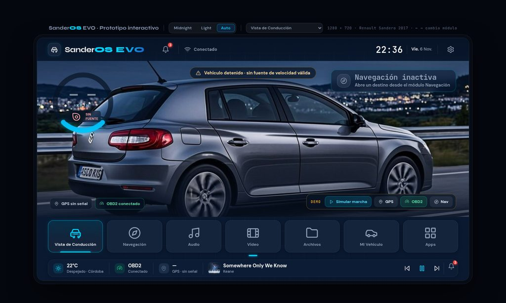
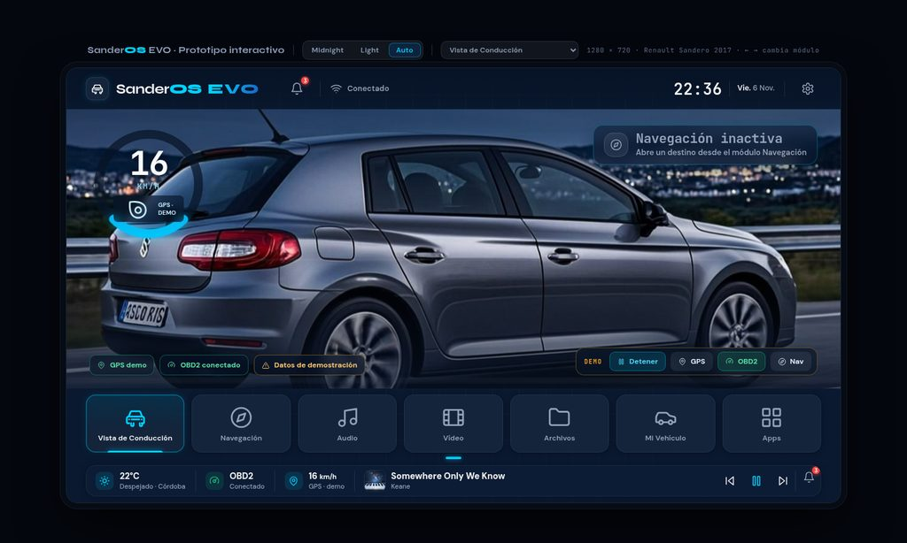
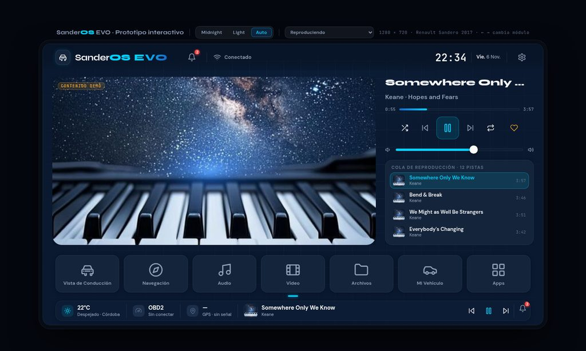
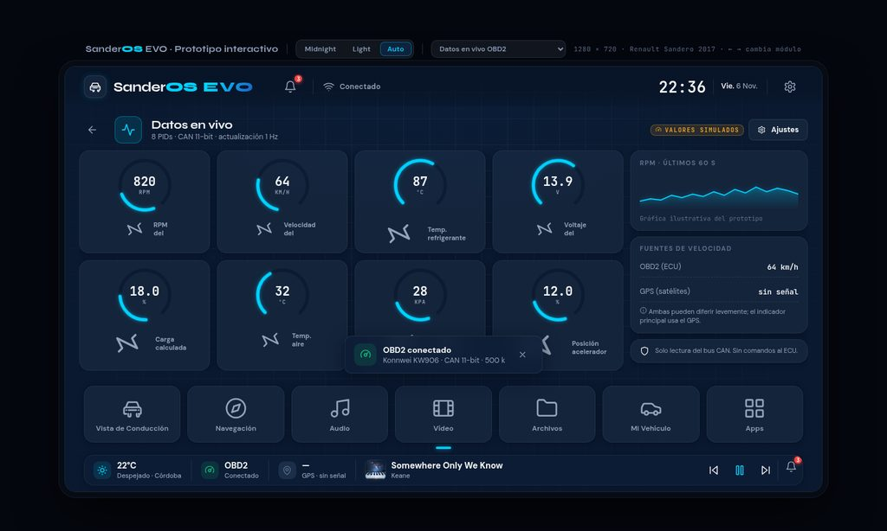
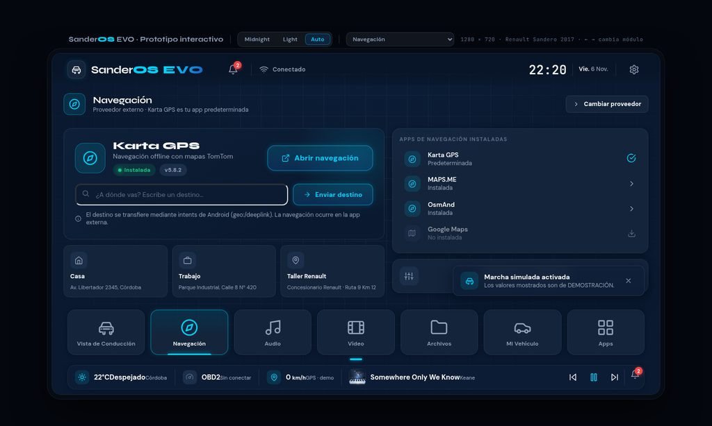
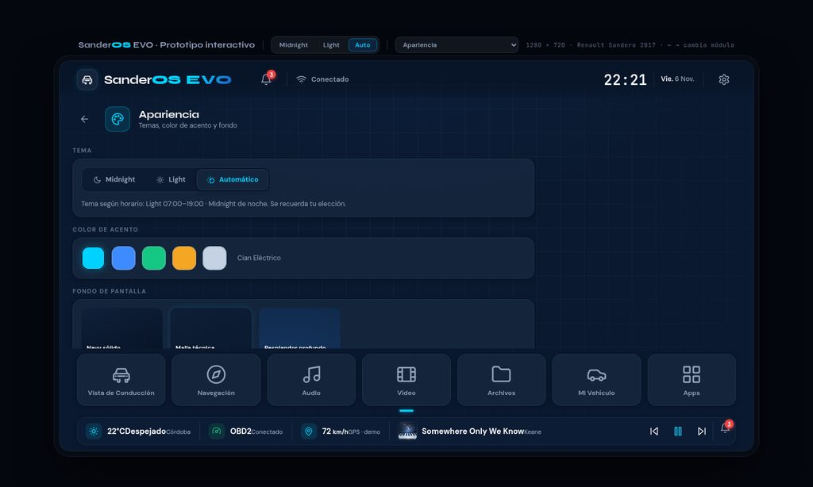

# SanderOS EVO

<p align="center">
  
</p>

<p align="center">
  <strong>Cockpit digital a medida para Renault Sandero 2017</strong><br>
  Android 11 · 1280 × 720 · AC8257 dual-core · 2 GB RAM · OBD2 Konnwei KW906
</p>

<p align="center">
  <a href="releases"></a>
  <a href="LICENSE"></a>
  
  
</p>

---

SanderOS EVO es un concepto completo de sistema de infoentretenimiento (IVI) para
una unidad head-unit aftermarket instalada en un **Renault Sandero 2017**. El
proyecto cubre todo el ciclo de diseño: identidad de marca, sistema de diseño
dual (Midnight / Light), un **prototipo HTML interactivo de 49 pantallas** y una
**guía de handoff** lista para el equipo de implementación en Android.

El prototipo y los datos de demostración están en **español** (interfaz del
vehículo).

## Probar el prototipo

No hay nada que instalar ni compilar: descarga este repositorio (o la
[última release](../../releases)) y abre `prototype/index.html` en Chrome,
Edge o Firefox. El archivo es **autocontenido** (~2 MB): fuentes, imágenes e
iconos van embebidos, funciona sin conexión.

| Atajo | Acción |
|---|---|
| Barra superior (fuera del marco) | Saltar a cualquier pantalla y cambiar de tema |
| ← / → | Módulo anterior / siguiente |
| `Esc` | Cerrar diálogos |
| Barra **DEMO** (Vista de conducción) | Simular marcha, GPS, OBD2 y navegación |

## Galería

| Vista de conducción | Barra DEMO |
|---|---|
|  |  |

| Reproducción de audio | OBD2 en tiempo real |
|---|---|
|  |  |

| Navegación | Ajustes (tema Light) |
|---|---|
|  |  |

## Objetivo técnico

| Parámetro | Valor |
|---|---|
| Vehículo | Renault Sandero 2017 |
| Plataforma | Android 11 (head unit aftermarket) |
| Pantalla | 1280 × 720 px, orientación horizontal |
| Procesador | AC8257 dual-core |
| Memoria | 2 GB RAM |
| Diagnóstico | Adaptador OBD2 Konnwei KW906 (ELM327 compatible, Bluetooth) |

## Módulos del prototipo

| Módulo | Pantallas incluidas |
|---|---|
| Arranque y bienvenida | Splash, asistente de configuración (idioma, tema, dock) |
| Conducción | Vista de conducción con animación de carretera, panel de notificaciones |
| Navegación | Pantalla de navegación (intents hacia apps externas, Karta GPS por defecto) |
| Audio | Biblioteca, reproducción, ecualizador, fuentes de audio |
| Vídeo | Galería y reproductor (bloqueado en marcha, solo audio) |
| Teléfono | Marcado, contactos, registro de llamadas |
| Vehículo | Estado del vehículo con renders de ángulos y colores |
| OBD2 | Conexión del adaptador, lectura en tiempo real, diagnóstico de fallos |
| Archivos | Explorador de archivos virtual, previsualización |
| Ajustes | Apariencia, dock, aplicaciones, información del sistema |

## Reglas de marca y producto

Estas decisiones son vinculantes para cualquier iteración futura:

- El wordmark se escribe **SanderOS** (nunca en cursiva): «Sander» en color de
  texto, «OS» en cian eléctrico, alineados en la base.
- **EVO** usa la fuente display Syne 800 con degradado cian-azul y tracking
  amplio: reconocible sin dominar la interfaz.
- El vídeo queda **forzosamente bloqueado durante la marcha** (sin opción de
  desactivar; solo continúa el audio).
- La navegación **no incrusta mapas**: lanza intents de Android hacia
  aplicaciones externas (Karta GPS por defecto).
- No se interfiere con la imagen de marcha atrás gestionada por la MCU original
  del vehículo.

## Política de datos de demostración

- Música, archivos y vídeo usan **datos de demostración** claramente ficticios.
- OBD2 y GPS arrancan en estado **«no conectado»**.
- Cualquier dato simulado en vivo lleva siempre la etiqueta **DEMO** visible:
  nunca se presenta telemetría inventada como si fuera real.

## Estructura del repositorio

```
sanderos-evo/
├── prototype/
│   ├── index.html          # Prototipo autocontenido (build v1.0.0)
│   ├── build.py            # Ensamblador: regenera index.html desde src/
│   └── src/                # Fuentes modulares (el orden 01–16 es significativo)
│       ├── css/            # Tokens, shell, componentes, módulos, animaciones
│       ├── html/           # Cuerpo del documento
│       ├── js/             # Iconos, datos, núcleo, pantallas, arranque
│       ├── fonts/          # Syne · DM Sans · JetBrains Mono (13 variantes woff2)
│       └── img/            # Renders y portadas embebidos en base64
├── docs/
│   ├── SanderOS_EVO_Handoff_Android.docx   # Guía de handoff (20 páginas)
│   └── SanderOS_EVO_Handoff_Android.pdf
├── assets/
│   ├── vehicle/            # 8 renders AI del Sandero (hero, ángulos, colores)
│   ├── brand/              # Logotipo horizontal/compacto y icono de app (SVG)
│   ├── media/              # Portadas y miniaturas de demo
│   └── screenshots/        # Capturas del prototipo para documentación
└── .github/
    ├── workflows/          # Release automática + demo en GitHub Pages
    └── release-notes/      # Notas de versión por tag
```

## Compilación del prototipo

Requisitos: Python 3.8+ (sin dependencias externas).

```bash
python3 prototype/build.py
```

Regenera `prototype/index.html` desde las fuentes de `prototype/src/`. La
integración continua verifica en cada push que el build commiteado esté
actualizado respecto a sus fuentes, así que **tras editar cualquier fuente,
ejecuta el build y commitea ambos juntos**.

## Publicación de versiones

El flujo de releases está automatizado:

1. Edita fuentes y regenera el prototipo (`python3 prototype/build.py`).
2. Actualiza `CHANGELOG.md` y añade `.github/release-notes/vX.Y.Z.md`.
3. Commitea, etiqueta y sube:

   ```bash
   git tag -a v1.1.0 -m "v1.1.0"
   git push origin main --tags
   ```

4. El workflow de release publica la versión con el prototipo y la documentación
   adjuntos como artefactos.

El detalle del primer despliegue (crear el repositorio remoto, publicar el tag
inicial y activar la demo en GitHub Pages) está en
[`docs/GUIA-GITHUB.md`](docs/GUIA-GITHUB.md).

## Documentación

- [`ARQUITECTURA-MODULOS.md`](docs/ARQUITECTURA-MODULOS.md) — **documento
  fundacional del launcher nativo**: núcleo (Driving View + Settings) con
  módulos activables, contrato `SanderModule`, bus de capacidades, reglas de
  dependencia y fases de construcción.
- [`SanderOS_EVO_Handoff_Android.pdf`](docs/SanderOS_EVO_Handoff_Android.pdf) —
  especificación de entrega: tokens de diseño, inventario de las 49 pantallas,
  especificación por módulo, componentes y notas de implementación en Android.
- [`assets/README.txt`](assets/README.txt) — inventario de la biblioteca de
  activos.

## Hoja de ruta

- [x] v1.0.0 — Prototipo completo de 49 pantallas, sistema dual de temas,
      activos de marca y documentación de handoff.
- [ ] v1.x — Refinamientos de interacción según feedback de uso real.
- [ ] v2.0 — Implementación nativa en Android como launcher modular
      (arquitectura definida en
      [`docs/ARQUITECTURA-MODULOS.md`](docs/ARQUITECTURA-MODULOS.md)).

## Licencia

Distribuido bajo la licencia [MIT](LICENSE).
